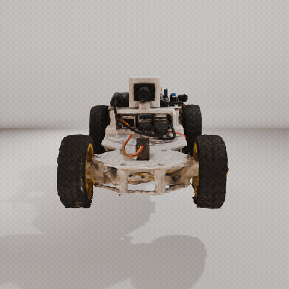
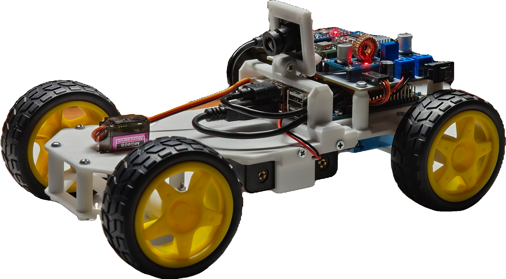
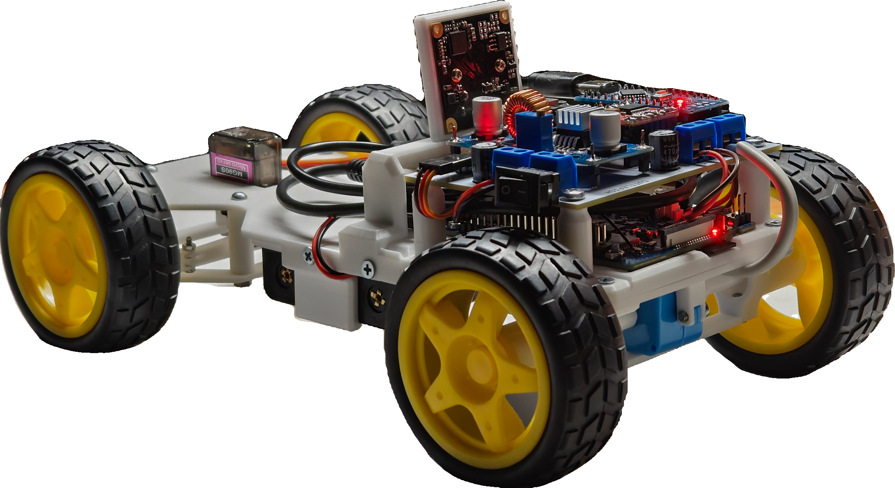
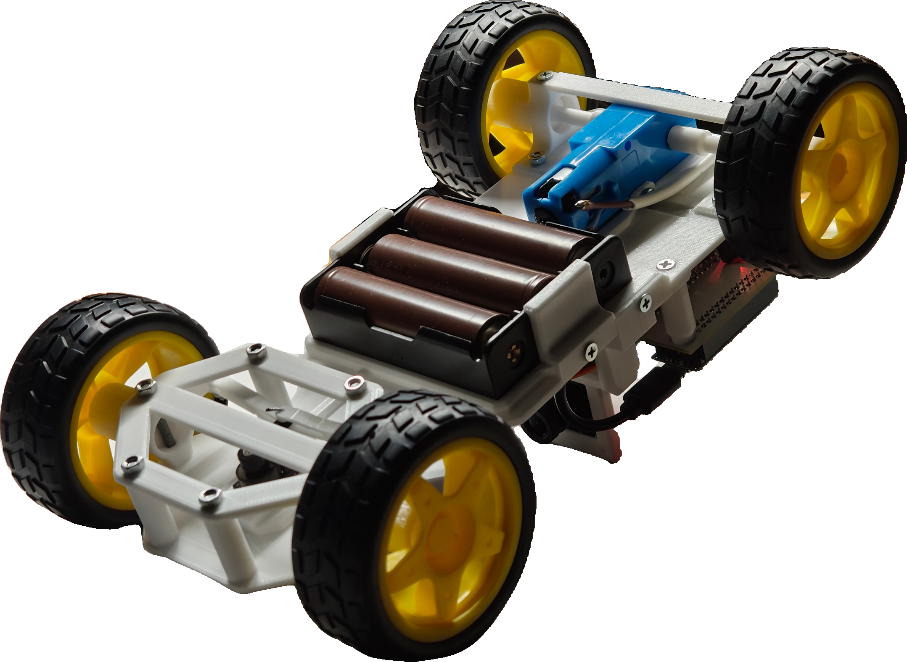
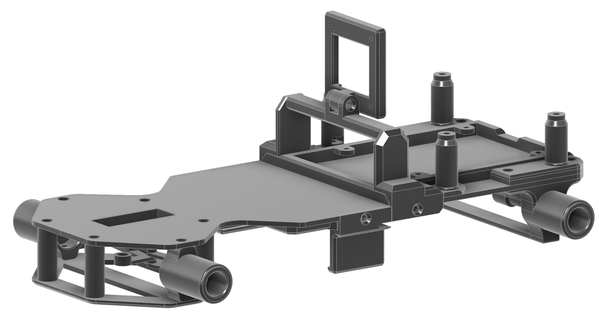

# Cuttlefish

<table>
  <tr>
    <td width="35%" valign="top">
      
    </td>
    <td width="65%" valign="top">
      <p>
        <strong>Cuttlefish</strong> is an autonomous RC car platform built around an Orange Pi 3B single-board computer and an Arduino Nano microcontroller.
      </p>
      <p>
        The vehicle uses a camera as its primary sensor. Video is processed by an autopilot running on the Orange Pi, which generates steering and motor commands.
        An Arduino Nano handles low-level motor and servo control.
      </p>
      <p>
        The project combines custom 3D-printed mechanics, dedicated power and interconnection electronics, embedded firmware, and computer vision software.
      </p>
    </td>
  </tr>
</table>

<br clear="left" />

## Features

- Custom 3D-printed chassis with Ackermann steering geometry.
- Rear-wheel drive with a 12 V geared DC motor.
- Arduino Nano for low-level hardware control.
- Orange Pi 3B for video processing and autonomous navigation.
- USB UVC camera with MJPEG output.
- Two autopilot deployment modes (**TODO**):
  - **Onboard:** all computations run directly on the Orange Pi.
  - **Remote:** video is streamed to an external computer, which runs the autopilot and sends control commands back.
- Modular architecture designed to support different autonomous driving algorithms (**TODO**).

## Project Status

| Component                  | Status         |
| -------------------------- | -------------- |
| Mechanical platform        | Complete       |
| Power electronics          | Complete       |
| Interconnection PCB        | Complete       |
| Arduino firmware           | Prototype      |
| Camera and video streaming | Complete       |
| Orange Pi control software | In development |
| Autonomous navigation      | Planned        |

## System Architecture

The system is divided into two main computing units, each responsible for a separate layer of control.

```text
                  Orange Pi 3B
              ┌───────────────────┐
 Camera ─────►│ Video acquisition │
              │        ↓          │
              │ Scene processing  │
              │        ↓          │
              │     Autopilot     │
              │        ↓          │
              │ Control commands  │
              └─────────┬─────────┘
                        │ USB Serial
                        │ 115200 baud
                        ▼
                  Arduino Nano
              ┌───────────────────┐
              │ Command parsing   │
              │ Motor PWM control │
              │ Servo control     │
              └────┬─────────┬────┘
                   │         │
               TB6612FNG   MG90S
                   │         │
                DC motor  Steering
```

### Orange Pi 3B

The SBC handles high-level operations:

- Camera capture and video processing.
- Autonomous navigation.
- Control algorithm execution.
- Communication with the Arduino.
- Video streaming and remote control interfaces.

### Arduino Nano

The MCU handles low-level hardware operations:

- DC motor speed and direction control.
- Steering servo control.
- Receiving and parsing commands over Serial.

This separation allows autonomous driving algorithms to be developed independently of the low-level hardware implementation.

## Hardware

<p align="center">
  
  
  
</p>

### Components

| Component                   | Description                                     |
| --------------------------- | ----------------------------------------------- |
| Chassis                     | Custom 3D-printed platform                      |
| Drive motor                 | 12 V geared DC motor                            |
| Steering                    | MG90S servo with Ackermann steering linkage     |
| Motor driver                | TB6612FNG                                       |
| Microcontroller (MCU)       | Arduino Nano                                    |
| Single-board computer (SBC) | Orange Pi 3B (2 GB RAM)                         |
| Camera                      | OV2710 GXIVISION, 2 MP, 1080p, 30 FPS, 100° FOV |
| Battery                     | 3 × 18650 Li-ion cells (3S)                     |
| Main DC-DC converter        | MP1584, 12 V to 5 V, 3 A                        |
| SBC DC-DC converter         | XL4015E, 12 V to 5 V, 4 A                       |

### Power System

The vehicle is powered by a 3S 18650 Li-ion battery pack.

```text
              3S Battery Pack
                 (~11.1 V)
                     │
                Power Switch
                     │
        ┌────────────┼────────────┐
        │            │            │
  TB6612FNG VM     MP1584      XL4015E
        │            │            │
    DC Motor      5 V rail     5 V rail
                     │            │
               Arduino Nano    Orange Pi
               + TB6612FNG VCC
               + Servo
```

The two DC-DC converters provide separate 5 V power rails for the control electronics and the single-board computer.

The battery cells are removable and charged using an external charger.

**Battery protection is not yet implemented.** The current prototype does not include a BMS or automatic undervoltage cutoff.
Battery voltage must therefore be monitored manually. Avoid discharging individual cells below approximately 3.0 V.

Two 470 µF / 16 V electrolytic capacitors are installed on the interconnection PCB to help stabilize the power supply.

### Arduino Pinout

| Arduino Pin | Function                            |
| ----------- | ----------------------------------- |
| D9          | Steering servo signal               |
| D3 (PWM)    | TB6612FNG PWMA                      |
| D2          | TB6612FNG AIN1                      |
| D4          | TB6612FNG AIN2                      |
| D5          | TB6612FNG STBY                      |
| USB         | Serial communication with Orange Pi |

The current implementation uses USB Serial communication at 115200 baud. Hardware UART communication is a possible future alternative.

**Note:** Arduino Nano uses 5 V logic, while Orange Pi GPIO uses 3.3 V logic. Direct UART connections require appropriate logic-level conversion.

## Mechanical Design

The chassis is designed in Fusion 360 and manufactured using 3D printing.



Source files and printable models are available in<br/>[`hardware/3d-models/`](hardware/3d-models/):

- `cuttlefish.f3d` — parametric Fusion 360 model.
- `cuttlefish.stl` — printable chassis model.

## Software

The software is split between the Arduino firmware and the Orange Pi application.

### Arduino Firmware

Source code: [`mcu-firmware/`](mcu-firmware/)

The current firmware implements basic manual control over Serial communication.

| Command   | Action                                |
| --------- | ------------------------------------- |
| `w`       | Move forward                          |
| `s`       | Move backward                         |
| `x`       | Stop the motor                        |
| `a` / `d` | Start steering left / right           |
| `e` / `q` | Stop steering left / right            |
| `c`       | Immediately return steering to center |

Current steering parameters:

- Servo center: 90°.
- Maximum steering offset: ±40°.
- Steering movement: 0.8° every 15 ms.
- Default motor PWM: 200 / 255.

The current firmware is a prototype intended for manual control.
A more advanced command protocol with numerical steering and motor speed values, telemetry, and a communication watchdog is planned.

### Orange Pi Software

The Orange Pi application is planned in **Rust** and will serve as the main interface between the camera, autopilot, and microcontroller.

Planned functionality:

- Camera capture through V4L2.
- Serial communication with Arduino.
- Pluggable autopilot implementations.
- Local and remote autonomous driving modes.
- Remote video streaming and manual control.
- Recording camera frames and corresponding control commands for dataset collection.

The target operating system is **Armbian (Debian 13)**.

### Camera and Video Streaming

The camera is an OV2710-based USB UVC device that provides MJPEG video without requiring software-side encoding.

A working video streaming prototype is available in [`software/cam-test/`](software/cam-test/).

It is implemented in Rust using:

- `axum` for the HTTP server and WebSocket communication.
- `v4l` for camera access through V4L2.

The application captures MJPEG frames and forwards them to connected clients over WebSocket.
A browser-based interface displays the video stream along with FPS and bandwidth statistics.

**Supported camera modes:**

| Resolution  | Frame rate |
| ----------- | ---------- |
| 1920 × 1080 | 30 FPS     |
| 1280 × 1024 | 30 FPS     |
| 1280 × 960  | 30 FPS     |
| 1280 × 720  | 30 FPS     |
| 1024 × 768  | 30 FPS     |
| 800 × 600   | 30 FPS     |
| 640 × 480   | 30 FPS     |
| 352 × 288   | 30 FPS     |
| 320 × 240   | 30 FPS     |

**Building and running:**

Install the required dependencies:

```bash
sudo apt install -y build-essential libclang-dev clang v4l-utils
```

Build the application:

```bash
cd cam-test
cargo build --release
```

Run the video server:

```bash
./target/release/cam-test /dev/video4 1280 720 30 8080
```

Arguments:

```text
[device] [width] [height] [fps] [port]
```

Open the following address in a browser:

```text
http://<orange-pi-ip>:8080/
```

The camera exposes separate video and metadata device nodes. Their `/dev/videoN` numbers may change between system boots.
For reliable device selection, use a persistent path from `/dev/v4l/by-id/`.

**Build note:** `libclang-dev` is required by `v4l2-sys-mit` for bindgen. The application must be built in a Linux environment with the required V4L2 headers.

## Autonomous Navigation

The project is intended to support multiple autonomous driving approaches through a modular autopilot interface.

Two approaches are currently considered:

### Classical Computer Vision

An OpenCV-based pipeline without machine learning:

- Image preprocessing.
- Road and lane detection using color segmentation and edge detection.
- Geometric analysis and perspective transformations.
- Steering angle estimation.
- PID-based control.

### Neural Network-Based Navigation

A neural network that predicts steering and potentially motor speed directly from camera frames.

One possible approach is **behavioral cloning**, where the model is trained using camera footage paired with control commands recorded during manual driving.

This requires a dataset collection pipeline and an appropriate training workflow.

### Deployment Modes

Both approaches are intended to support two execution modes.

| Aspect              | Onboard                        | Remote                                  |
| ------------------- | ------------------------------ | --------------------------------------- |
| Computation         | Orange Pi 3B                   | External computer                       |
| Video processing    | Local                          | Remote                                  |
| Network dependency  | None                           | Wi-Fi                                   |
| Latency             | Lower                          | Includes network and streaming overhead |
| Computing resources | Limited by RK3566 and 2 GB RAM | Depends on external hardware            |

The remote mode uses WebSocket communication to transmit camera frames to an external computer and receive control commands in return.

The Orange Pi acts as a bridge between the network and the Arduino.

### Hardware Acceleration

The Orange Pi 3B is based on the Rockchip RK3566 and provides an NPU rated at approximately 0.8 TOPS.

Hardware acceleration through the RKNN toolkit is a potential option for neural network inference. Integration with the Rust application is yet to be investigated.

## Repository Structure

```text
cuttlefish/
├── hardware/
│   ├── 3d-models/   # Fusion 360 source and printable models
│   └── schemas/     # KiCad schematics, PCB, Gerber files and BOM
├── mcu-firmware/    # Arduino Nano firmware
├── README.md        # Project documentation
└── software/
    └── cam-test/    # Rust-based camera streaming prototype
```

Additional software components will be added as development progresses.

## Future Development

The following improvements are planned:

- [ ] Implement the Orange Pi control application.
- [ ] Develop a unified numerical Serial command protocol.
- [ ] Add a communication watchdog and fail-safe motor stop.
- [ ] Implement autonomous navigation algorithms.
- [ ] Collect training data for neural network-based navigation.
- [ ] Add battery voltage monitoring and undervoltage protection.
- [ ] Evaluate the accuracy of camera-only navigation.
- [ ] Measure video streaming latency and system performance.
- [ ] Investigate RKNN-based neural network acceleration.
- [ ] Improve calibration and repeatability across multiple vehicles.

The platform is also intended to serve as a reproducible hardware base for educational events and robotics hackathons.

## Hardware and PCB Files

The KiCad project is available in [`hardware/schemas/`](hardware/schemas/).

It includes:

- `cuttlefish-carrier.kicad_sch` — schematic.
- `cuttlefish-carrier.kicad_pcb` — PCB layout.
- `gerber/` — manufacturing files.
- `cuttlefish-carrier.csv`, `cuttlefish-carrier.xlsx` — bills of materials.
- `cuttlefish-carrier-all-pos.csv` — component placement data.

## License

Cuttlefish consists of hardware and software components distributed under separate open-source licenses.

| Component                      | License        |
| ------------------------------ | -------------- |
| Hardware designs (`hardware/`) | CERN-OHL-S-2.0 |
| MCU firmware (`mcu-firmware/`) | GPL-3.0-only   |
| Software (`software/`)         | GPL-3.0-only   |

See the respective `LICENSE` files in each directory
for the full license texts.

Third-party components remain under their respective licenses.
